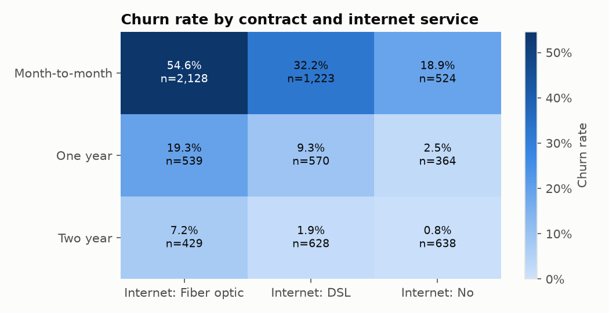
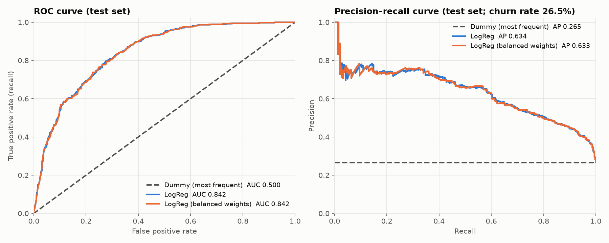
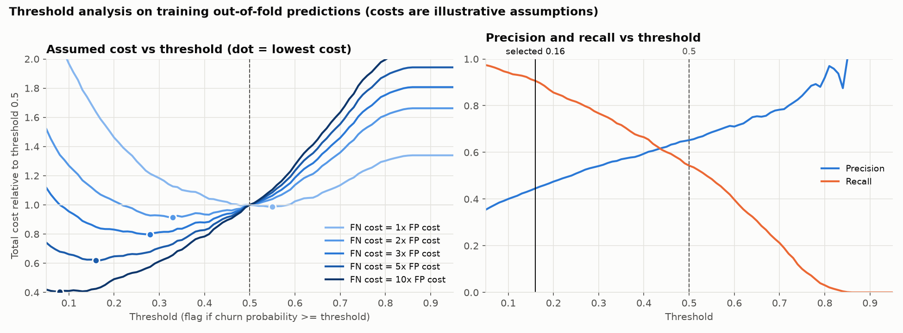

# Customer Churn Intelligence Platform

An end-to-end churn analytics and prediction project on the public IBM Telco Customer Churn dataset (7,043 customers). It covers data validation, SQL and pandas analysis, a leakage-safe scikit-learn model with a cost-based decision threshold, and an input-validated FastAPI prediction service, all reproducible and covered by automated tests.

> **Scope in one line:** a rigorous, end-to-end workflow on a single retrospective snapshot. It is **not** a production-proven early-warning system (see [Limitations and next steps](#limitations-and-next-steps)).

## Overview

**Why it matters.** When a subscription business knows which customers are at risk of leaving, it can target retention offers. But each offer costs money, so the goal is not the highest accuracy. It is deciding whom to contact.

**What I built**

- **Data validation:** schema, category, range and cross-column checks on the raw CSV, with a SHA-256 checksum for provenance.
- **Exploratory analysis:** churn by customer segment in pandas, cross-checked against 7 independent SQL queries.
- **Leakage-safe modelling:** a scikit-learn pipeline, with a Dummy baseline, logistic regression, a decision tree and a random forest compared using cross-validation on training data only.
- **Decisions on training data only:** calibration was checked and a cost-based decision threshold chosen, both from training data.
- **Prediction service:** the selected model is saved with provenance metadata and served through FastAPI with strict input validation.
- **Integrity checking:** a one-command check confirms the data, the train/test split, the frozen historical results, the model artifact and the API wiring are intact.

**Headline results** (details in [Model results](#model-results))

- **26.5%** of customers churned.
- On a held-out test set, logistic regression **ranks** churners well: ROC-AUC **0.842**, PR-AUC **0.634** (a no-skill model scores 0.265).
- Under an *assumed* cost ratio (a missed churner costs 5× an unnecessary retention offer), a threshold of **0.16** caught **337 of 374** held-out churners, at the price of **423** unnecessary offers.

## Key business insights

From [reports/phase2_findings.md](reports/phase2_findings.md), computed on all 7,043 customers:

| Segment | Churn rate | Customers |
|---|---:|---:|
| Month-to-month contract | 42.7% | 3,875 |
| Two-year contract | 2.8% | 1,695 |
| First year of tenure (0–12 months) | 47.4% | 2,186 |
| More than 4 years of tenure (49+ months) | 9.5% | 2,239 |
| Pays by electronic check | 45.3% | 2,365 |
| Pays by automatic credit card | 15.2% | 1,522 |
| Fiber-optic internet | 41.9% | 3,096 |
| DSL internet | 19.0% | 2,421 |

- **The highest-risk segment is month-to-month customers with fiber-optic internet:** 54.6% churn. They make up 30.2% of all customers but account for **62.2% of all churners** (1,162 of 1,869).
- Fiber churns more than DSL **within every contract type**, and month-to-month churns most **within every internet type**, so neither pattern is simply a stand-in for the other.



> **These are associations, not causal effects.** Customers choose their contracts and payment methods, and the factors are entangled with each other. The data does not show that moving a customer to a two-year contract would reduce their churn risk. Tenure also has a built-in bias: for churned customers it stops at the moment they left.

## Model results

### Ranking performance (independent of any threshold)

The model outputs a churn probability for each customer. ROC-AUC and PR-AUC measure how well those probabilities **rank** churners above non-churners, without choosing any cut-off.

- **Held-out test set (1,409 customers, 374 churners):** ROC-AUC 0.842, PR-AUC 0.634. A model that always predicts "no churn" scores 0.500 and 0.265.
- **Why logistic regression:** it was compared with a depth-5 decision tree and a 300-tree random forest using 5-fold cross-validation on the training data only. Cross-validated ROC-AUC was 0.846 (LogReg), 0.848 (random forest) and 0.827 (decision tree). The forest's gain (+0.0017, standard error 0.0033, better in 3 of 5 folds) was within noise, so the simpler, interpretable model was kept.
- **Its probabilities are well calibrated** (expected calibration error 0.010 on training cross-validation), so they can be read as rough probabilities.



### Threshold trade-off (illustrative, based on assumed costs)

To act on a probability, the business picks a **threshold**: flag the customer if the probability is at least that value. This is a **business decision**, not a model property. The 0.16 below minimised total cost on training data **under an assumed 5:1 cost ratio**. That ratio is an illustration, not a measured business cost.

| Held-out test set (374 churners) | Threshold 0.5 (default) | Threshold 0.16 (cost-based) |
|---|---:|---:|
| Customers flagged for an offer | 319 | 760 |
| Churners caught (true positives) | 210 | 337 |
| Churners missed (false negatives) | 164 | 37 |
| Unnecessary offers (false positives) | 109 | 423 |
| Precision | 0.658 | 0.443 |
| Recall | 0.561 | 0.901 |
| Accuracy | 0.806 | 0.674 |

Lowering the threshold catches far more churners at the price of many more unnecessary offers. Accuracy *falls*, which is why accuracy alone is the wrong measure for this problem. With real costs, the threshold should be re-derived from training data (see [Exploring other cost assumptions](#exploring-other-cost-assumptions-safely)).



*The threshold chart uses training out-of-fold predictions, which is how the threshold was chosen. The test-set table above was computed once, after that choice.*

### Detailed results (verified against saved reports)

Every value below is read from a saved result file, and `tests/test_docs_consistency.py` fails if any of them drifts.

<!-- results-table:start -->
| Result | Value | Source file |
|---|---|---|
| Churn rate, all 7,043 customers | 0.2654 | `reports/data_validation.json` |
| Phase 3 test, Dummy (always "no churn") accuracy | 0.735 | `reports/phase3/metrics.json` |
| Phase 3 test, LogReg ROC-AUC | 0.842 | `reports/phase3/metrics.json` |
| Phase 3 test, LogReg PR-AUC | 0.634 | `reports/phase3/metrics.json` |
| Phase 3 test, LogReg precision at 0.5 | 0.658 | `reports/phase3/metrics.json` |
| Phase 3 test, LogReg recall at 0.5 | 0.561 | `reports/phase3/metrics.json` |
| Phase 4 training CV, LogReg ROC-AUC | 0.846 | `reports/phase4/model_comparison_summary.csv` |
| Phase 4 training CV, random forest ROC-AUC | 0.848 | `reports/phase4/model_comparison_summary.csv` |
| Phase 4 training CV, decision tree ROC-AUC | 0.827 | `reports/phase4/model_comparison_summary.csv` |
| Phase 4 training OOF calibration error (ECE), LogReg | 0.010 | `reports/phase4/phase4_results.json` |
| Selected threshold (assumed 5:1 cost ratio) | 0.16 | `reports/phase4/decisions.json` |
| Phase 4 test at 0.16, precision | 0.443 | `reports/phase4/final_test_evaluation.json` |
| Phase 4 test at 0.16, recall | 0.901 | `reports/phase4/final_test_evaluation.json` |
| Phase 4 test at 0.16, churners caught (TP) | 337 | `reports/phase4/final_test_evaluation.json` |
| Phase 4 test at 0.16, unnecessary offers (FP) | 423 | `reports/phase4/final_test_evaluation.json` |
| Phase 4 test at 0.16, churners missed (FN) | 37 | `reports/phase4/final_test_evaluation.json` |
<!-- results-table:end -->

*Glossary:* **CV** = cross-validation. **OOF** (out-of-fold) = each training row predicted by a model that never saw it. **ECE** = expected calibration error. **PR-AUC** = area under the precision-recall curve. "Phase 3/4 test" refers to the two times the held-out test set was scored: at 0.5 in Phase 3, and at the pre-declared 0.16 in Phase 4.

## Architecture and tech stack

```
download.py ─► data/raw CSV ─► validation.py (schema and data-quality rules) ─► analysis.py / sql/*.sql (EDA, SQL cross-checked)
                                        │
                                        ▼
                     features.py: stateless typing + seed-42 stratified 80/20 split
                            │                                          │
                 training rows (5,634)                      test rows (1,409): scored once in Phase 3
                            │                                and once in Phase 4, now frozen
                            ▼
      modeling.py Pipeline (impute + scale + one-hot + LogReg), 5-fold CV, out-of-fold analysis
                            │
                            ▼
      artifact.py ─► models/churn_logreg_v1.joblib + .metadata.json (threshold 0.16, provenance)
                            │  loaded once, hash + version checked
                            ▼
      api/main.py (FastAPI): /health  /model-info  /predict  ◄── Pydantic input validation (api/schemas.py)

      verify.py: read-only integrity and wiring check over all of the above
```

**Tech stack:** Python 3.11 · pandas · NumPy · SQLite (`sqlite3`) · scikit-learn · matplotlib · FastAPI · Pydantic · uvicorn · pytest. Exact versions are in [requirements.txt](requirements.txt).

**Skills demonstrated**

- **Data analysis:** a typed SQLite view and 7 read-only SQL queries cross-checked against pandas; segment churn rates with 95% confidence intervals; data-quality investigation (blank values, duplicate profiles with conflicting outcomes).
- **Data science:**
  - a leakage-safe preprocessing pipeline
  - paired cross-validated model comparison with decision rules written before the results were known
  - calibration assessment and a cost-based threshold
  - odds ratios and grouped permutation importance
  - explicit handling of retrospective leakage
- **ML engineering:** a versioned model artifact with metadata, hash and version checks; FastAPI with Pydantic validation and safe error responses; unit, integration and tamper-detection tests; reproducibility fingerprints.

## Charts and reports

The three charts above are a selection. The full analysis, with every chart, is in the generated reports:

- [reports/phase2_findings.md](reports/phase2_findings.md): exploratory analysis and SQL checks (10 charts)
- [reports/phase3_model_evaluation.md](reports/phase3_model_evaluation.md): leakage-safe baseline evaluation (2 charts)
- [reports/phase4_model_analysis.md](reports/phase4_model_analysis.md): model comparison, calibration, threshold, interpretation (5 charts)

## Setup and reproducibility

### Prerequisites

- **Git**, and an internet connection (to clone, install packages and download the dataset).
- **Python 3.11.** The saved model artifact is tied to scikit-learn 1.9.1, as pinned in `requirements.txt`.
- **Windows with PowerShell** is the only environment this project has been developed and verified on (Windows 10, x64, CPython 3.11.9). On macOS/Linux the standard equivalents (`python3.11 -m venv .venv`, then `source .venv/bin/activate`) should apply, but they have **not been tested**.

```powershell
git clone https://github.com/amrinder-3184/customer-intelligence-platform.git
cd customer-intelligence-platform
py -3.11 -m venv .venv
.\.venv\Scripts\Activate.ps1                 # if blocked: Set-ExecutionPolicy -Scope CurrentUser RemoteSigned
python -m pip install -r requirements.txt
```

`requirements.txt` pins the direct dependencies. `requirements-lock.txt` records **every** installed package exactly as in the verified environment, and is specific to **Windows / CPython 3.11.9**. For example, it includes `colorama`, which pytest requires only on Windows.

### Reproduce from a fresh clone (never touches the test set)

None of these commands scores the held-out test set.

```powershell
python -m churn_platform.download            # 1. fetch the raw CSV (~1 MB); prints its SHA-256
python -m churn_platform.inspect_data        # 2. validation (exit code 0 = passed)
python -m churn_platform.eda                 # 3. optional: regenerate EDA tables, charts, SQL DB
python -m churn_platform.make_split          # 4. recreate data/processed/train_test_split.csv
python -m churn_platform.artifact            # 5. fit the selected model on training rows -> models/
python -B -m churn_platform.verify           # 6. integrity + wiring check (writes nothing)
python -m pytest -q                          # 7. full test suite
uvicorn churn_platform.api.main:app --host 127.0.0.1 --port 8000   # 8. serve; docs at /docs (Ctrl+C to stop)
```

> **Warning: steps 2 and 3 overwrite committed files.** `inspect_data` rewrites `reports/data_validation.json`. `eda` rewrites `reports/phase2_findings.md`, `reports/phase2_summary.json`, every CSV in `reports/tables/`, and the 10 EDA charts in `reports/figures/`. On a different operating system (line endings) or different library versions (chart rendering), these may then show as modified in `git status`, even though the analysis is the same. `verify` does not check these files. To discard such changes, run `git restore reports/`. Steps 1 and 4–8 write only to git-ignored locations (`data/`, `models/`), or to nothing.

- **`make_split`** refuses to write anything unless the raw file's SHA-256 and the recomputed train/test customerIDs match `reports/split_fingerprint.json`. If the split file already exists, it is compared and never overwritten. It fits no model and scores no rows.
- **`artifact`** refuses to fit unless the split matches, and checks that its coefficients equal the saved Phase 4 coefficients.
- **`verify`** fits no model and computes no evaluation metrics. It does read the churn labels, to rebuild the stratified train/test split and compare it with the fingerprint. Its only prediction is one made-up customer sent through the API.

### Historical evaluation commands (audit only: these score the test set)

| Command | What it did | Status |
|---|---|---|
| `python -m churn_platform.train_baseline` | Phase 3: split, CV, and **test-set evaluation** at threshold 0.5 | Done once. Re-running only reproduces the same numbers, but it is still a repeated test evaluation, so don't. |
| `python -m churn_platform.analyze_models` (full mode) | Phase 4: decisions from training data, then **one** test evaluation at 0.16 | Done once. Protected by a lock: it refuses to score the test set under different decisions. |

Both commands **overwrite the frozen Phase 3/4 results** in `reports/` (and `train_baseline` also rewrites the split file). Those outputs are checked by `verify` against `reports/historical_results.sha256`. Any further model change needs **new data** for an honest evaluation, because this test set has already been used twice.

### Exploring other cost assumptions safely

```powershell
python -m churn_platform.analyze_models --skip-test --fn-cost 3
```

This uses training data only and writes **only** to `reports/phase4_exploratory/` (git-ignored). The historical Phase 4 results are never overwritten.

### Integrity checks

`python -B -m churn_platform.verify` prints a pass/fail table and exits non-zero if any check fails:

| Check | What it confirms |
|---|---|
| raw data | SHA-256 equals the committed fingerprint |
| validation | validation rules pass (run in memory; no report written) |
| split | recomputed split and saved split file both match `split_fingerprint.json` |
| historical results | all 24 frozen Phase 3/4 outputs match `historical_results.sha256` |
| model artifact | hash, scikit-learn version, feature order, threshold = Phase 4 decision, trained on the fingerprinted training IDs |
| coefficient parity | artifact coefficients equal `reports/phase4/logreg_coefficients.csv` |
| API smoke test | in-process `/health` 200, `/model-info` 200, valid `/predict` 200, invalid `/predict` 422 |

The two committed reference files were derived once from the trusted outputs and must never be regenerated from modified files. `.gitattributes` stores `reports/**` byte-for-byte, because Git's line-ending conversion would otherwise change the hashed bytes. **A passing `verify` shows that the parts are intact and connected. It does not show that the model is useful in production.**

## API reference

```
python -m churn_platform.artifact  --> models/churn_logreg_v1.joblib          fitted Pipeline: imputer + scaler + one-hot + LogReg
                                   --> models/churn_logreg_v1.metadata.json   schema, threshold 0.16, costs, provenance, versions
churn_platform/api/main.py (FastAPI), model loaded ONCE at startup:
   request JSON --> schemas.CustomerFeatures (Pydantic validation) --> predictor.ChurnPredictor.predict --> response JSON
```

- **No retraining at startup or per request.** The saved pipeline already contains the medians, scaling and category lists learned from the 5,634 training rows.
- **Training rows only.** `artifact.py` refuses to fit unless the split matches the reference. It never scores the test set.
- **Artifact safety.** joblib/pickle files can run code when loaded, so the `.joblib` file is a **trusted local file only**. Never load an uploaded artifact. Its SHA-256 is checked against the metadata *before* unpickling, and a different scikit-learn version is refused.

### Endpoints

| Method | Path | Returns |
|---|---|---|
| GET | `/health` | `200 {"status":"ok","model_loaded":true,...}`, or `503` if the model failed to load |
| GET | `/model-info` | name, version, the 19 predictors and allowed values, threshold, cost assumptions, training summary, historical test results, limitations (no paths or hashes) |
| POST | `/predict` | churn probability, `predicted_churn` at 0.16, risk label, threshold, model version, and a disclaimer |

Interactive documentation is at `http://127.0.0.1:8000/docs` while the server is running.

### Example (a made-up customer, not a dataset record)

Request body:

```json
{"gender":"Female","SeniorCitizen":0,"Partner":"Yes","Dependents":"No","tenure":5,"PhoneService":"Yes","MultipleLines":"No","InternetService":"Fiber optic","OnlineSecurity":"No","OnlineBackup":"No","DeviceProtection":"No","TechSupport":"No","StreamingTV":"Yes","StreamingMovies":"No","Contract":"Month-to-month","PaperlessBilling":"Yes","PaymentMethod":"Electronic check","MonthlyCharges":85.5,"TotalCharges":430.25}
```

Send it from PowerShell:

```powershell
$body = '{"gender":"Female","SeniorCitizen":0,"Partner":"Yes","Dependents":"No","tenure":5,"PhoneService":"Yes","MultipleLines":"No","InternetService":"Fiber optic","OnlineSecurity":"No","OnlineBackup":"No","DeviceProtection":"No","TechSupport":"No","StreamingTV":"Yes","StreamingMovies":"No","Contract":"Month-to-month","PaperlessBilling":"Yes","PaymentMethod":"Electronic check","MonthlyCharges":85.5,"TotalCharges":430.25}'
Invoke-RestMethod -Method Post -Uri http://127.0.0.1:8000/predict -ContentType "application/json" -Body $body
```

Response, captured from a local run:

```json
{"churn_probability": 0.7047825979427462, "predicted_churn": true, "risk_label": "high", "threshold": 0.16,
 "model_name": "churn-logreg", "model_version": "1.0.0",
 "note": "Model estimate from a retrospective model trained on historical data; not a guarantee that this customer will or will not churn."}
```

An invalid request returns `422` with field-level messages, for example `Contract: Input should be 'Month-to-month', 'One year' or 'Two year'` and `customerID: Extra inputs are not permitted`.

### Validation rules

- **All 19 predictors are required**, with the exact CSV column names. Category values must match the dataset exactly (case-sensitive). `SeniorCitizen` is the integer `0` or `1`.
- **Numbers are strict:** `tenure` must be an integer from 0 to 120. `MonthlyCharges` must be 0–1000 and `TotalCharges` 0–100000. Strings, booleans, NaN and Infinity are rejected.
- **`TotalCharges` is required but may be `null` only when `tenure` is 0**, the only situation where it was blank in the training data. The fitted pipeline fills a null with the *training* median and sets its missing-indicator.
- **Unknown fields are rejected, including `customerID`.** So are service combinations that never occur in the data.

### The 0.16 threshold

`predicted_churn` is `churn_probability >= 0.16`. That threshold minimised the total cost on *training out-of-fold* predictions under an **assumed** cost ratio. **It is not a validated business policy.** With real costs, re-run the threshold analysis (`--skip-test`), review it, and rebuild the artifact. The threshold lives in metadata, not code. `risk_label` is descriptive (`low` < 0.16 ≤ `elevated` < 0.5 ≤ `high`); only the threshold decides `predicted_churn`.

## Project structure

```
customer-intelligence-platform/
├── churn_platform/          # the Python package
│   ├── config.py            # paths, dataset URL, random seed
│   ├── download.py          # downloads the raw CSV and prints its SHA-256
│   ├── validation.py        # Phase 1: schema + data-quality rules (pure functions)
│   ├── inspect_data.py      # Phase 1: CLI; prints a report, writes reports/data_validation.json
│   ├── analysis.py          # Phase 2: typed analysis frame, churn rates, CIs, duplicates
│   ├── sql_analysis.py      # Phase 2: builds SQLite DB, runs SQL, compares with pandas
│   ├── plots.py             # Phase 2–4: matplotlib charts
│   ├── findings.py          # Phase 2: writes reports/phase2_findings.md from results
│   ├── eda.py               # Phase 2: CLI that runs the EDA
│   ├── features.py          # Phase 3: target/predictors, stratified split, train-test overlap
│   ├── modeling.py          # Phase 3: preprocessing pipeline, models, CV, metrics
│   ├── model_report.py      # Phase 3: writes reports/phase3_model_evaluation.md
│   ├── train_baseline.py    # Phase 3: CLI (scores the test set; historical)
│   ├── model_selection.py   # Phase 4: out-of-fold comparison of LogReg / tree / forest
│   ├── calibration.py       # Phase 4: Brier, log loss, ECE, nested calibrators
│   ├── thresholds.py        # Phase 4: confusion counts and cost per threshold
│   ├── interpretation.py    # Phase 4: odds ratios, permutation importance
│   ├── phase4_report.py     # Phase 4: writes reports/phase4_model_analysis.md
│   ├── analyze_models.py    # Phase 4: CLI; full mode scores the test set (historical)
│   ├── artifact.py          # Phase 5: fit selected model on TRAINING rows, save + metadata
│   ├── make_split.py        # Phase 6: recreate the split file without fitting or scoring
│   ├── verify.py            # Phase 6: read-only integrity and wiring check
│   └── api/
│       ├── schemas.py       # Phase 5: Pydantic request/response models (exact predictor schema)
│       ├── predictor.py     # Phase 5: artifact loading + prediction, no HTTP code
│       └── main.py          # Phase 5: FastAPI app: /health, /model-info, /predict
├── sql/                     # typed SQLite view + 7 read-only analytical queries
├── data/raw/                # raw CSV (git-ignored, re-downloadable)
├── data/processed/          # SQLite DB, train_test_split.csv (git-ignored, rebuilt)
├── models/                  # churn_logreg_v1.joblib + .metadata.json (git-ignored, rebuilt)
├── reports/
│   ├── split_fingerprint.json        # expected train/test customerID hashes (committed reference)
│   ├── historical_results.sha256     # frozen Phase 3/4 result hashes (committed reference)
│   ├── phase2_findings.md, phase3_model_evaluation.md, phase4_model_analysis.md
│   ├── phase3/, phase4/              # machine-readable results (Phase 3/4 are frozen)
│   └── figures/, tables/             # generated charts and CSV tables
├── docs/INTERVIEW_GUIDE.md  # design decisions and concepts, phase by phase
├── tests/                   # pytest suite
├── .gitattributes           # keeps report bytes exact so the committed hashes stay valid
├── pyproject.toml           # project metadata + pytest config
├── requirements.txt         # direct dependencies, pinned
└── requirements-lock.txt    # every installed package version (Windows / CPython 3.11.9 only)
```

`reports/phase4_exploratory/` appears only after a `--skip-test` run and is git-ignored.

## Data provenance

- **Dataset:** IBM Telco Customer Churn (a fictional telecom company created by IBM for demos)
- **Source:** <https://github.com/IBM/telco-customer-churn-on-icp4d> (`data/Telco-Customer-Churn.csv`). That source repository is Apache-2.0 licensed.
- **Verified file:** 970,457 bytes, SHA-256 `16320c9c1ec72448db59aa0a26a0b95401046bef5d02fd3aeb906448e3055e91`
- **Grain:** one row per customer, a single snapshot in time. There are no dates, so churn timing can't be studied.
- The raw file is **not committed**. Run the download command to recreate it.

**Validation findings (from the real file)**

- 7,043 rows × 21 columns, with unique `customerID`s and no invalid categories or out-of-range numbers.
- Target `Churn`: 5,174 No / 1,869 Yes (churn rate 26.54%), so the classes are imbalanced.
- `TotalCharges` is stored as text. 11 values are a single space `" "`, and all 11 belong to customers with `tenure = 0`, who appear not to have been billed yet.
- `SeniorCitizen` is coded `0/1` while the other flags are `Yes/No`.
- The service add-on columns use a third value (`"No phone service"` / `"No internet service"`). They were checked for consistency with `PhoneService` / `InternetService`, with zero violations.
- 73 rows (33 groups) share identical features under different IDs. 18 of those groups contain both churners and non-churners, so some label noise is irreducible.

## Methodology details

### EDA and SQL

`python -m churn_platform.eda` runs the whole analysis in about 5 seconds. It stops early if validation fails, and it exits with code 1 if SQL and pandas disagree or the raw CSV's checksum changes. The transformations below are for analysis only: the raw CSV is never written to.

| Raw | Analysis | Why |
|---|---|---|
| `TotalCharges` text, 11 × `" "` | float; blanks → **NaN** (not 0), plus a `TotalCharges_blank` flag | keeps missing values visible |
| `tenure`, `MonthlyCharges` text | int / float | arithmetic |
| `Churn` Yes/No | extra `churned` 0/1 column | the churn rate is then simply the mean |
| — | `tenure_group`: 0-12, 13-24, 25-48, 49+ months | readable segments (round-number cut-offs) |
| — | `monthly_charges_band`: <35, 35-70, 70-90, 90+ $ | same |

**SQL design.** The raw CSV is loaded as text into `customers_raw`. The view `customers` converts the types and builds the bands *in SQL*, independently of pandas, and every query result is compared against pandas. The queries are fixed, read-only and have no parameters. Duplicate profiles are reported in `reports/tables/duplicate_profiles.csv`, not removed.

### Leakage-safe baseline

1. **Stateless typing before the split.** Blank `TotalCharges` becomes NaN, and nothing is learned at this step.
2. **Stratified 80/20 split, seed 42**, made before anything is fitted.
3. **Every learned step is inside one scikit-learn `Pipeline`, fitted on training rows only:** median imputation plus a missing indicator, `StandardScaler` and `OneHotEncoder(handle_unknown="ignore")`.
4. **Choices are made with 5-fold cross-validation on training data only:** median+indicator vs zero-fill, and unweighted vs `class_weight="balanced"`.
5. **The test set was scored once** at a fixed 0.5 threshold. No result fed back into any choice.
6. **`customerID` is never a predictor.**

**Models:** `DummyClassifier(most_frequent)` as the baseline; `LogisticRegression(C=1.0, max_iter=1000)`, unweighted (primary); and the same model with `class_weight="balanced"` for comparison.

### Model comparison, calibration and threshold

**Every decision used only the 5,634 training rows**, through out-of-fold (OOF) predictions on the same 5 folds:

| Question | Method | Pre-declared decision rule |
|---|---|---|
| Better model? | LogReg vs depth-5 tree vs 300-tree forest (fixed settings, no search) | switch only if ROC-AUC **and** AP improve by > 2 SE of the paired fold difference |
| Trustworthy probabilities? | uncalibrated vs sigmoid vs isotonic (`CalibratedClassifierCV`, nested in each fold) | adopt only if OOF Brier **and** log loss improve, and Brier improves in ≥ 4/5 folds |
| Which threshold? | cost = FP×`--fp-cost` + FN×`--fn-cost` on thresholds 0.05–0.95 | lowest OOF cost; ties go to the higher threshold. **Costs are illustrative assumptions (default 1 and 5).** |
| What drives predictions? | LogReg odds ratios; permutation importance on validation folds, including correlated groups | none; descriptive only |

**Test-set lock.** Decisions were written to `reports/phase4/decisions.json` before the final model was scored on the test set once. `final_test_evaluation.json` stores a hash of those decisions, and a run with *different* decisions is refused without changing any file.

## Limitations and next steps

**Limitations**

- **Retrospective model, not an early-warning system.** For churned customers, `tenure` and `TotalCharges` were recorded *at* churn, so the model partly learned what churned customers look like at the end. A real early-warning model needs features frozen at a prediction date and churn observed afterwards. Without those two columns, training CV ROC-AUC drops from 0.846 to 0.832.
- **Not production-proven.** The model has not been deployed or evaluated on future customers. There is no authentication, monitoring or drift detection, and the artifact is tied to scikit-learn 1.9.1.
- **The threshold rests on an assumption.** The 5:1 cost ratio is illustrative, and the cost model assumes every contacted churner is retained.
- **Associations, not causes.** Contract, tenure, internet type, price and payment method are entangled. No result shows that changing a feature would change churn.
- **Synthetic, single-snapshot data** (7,043 customers) with irreducible label noise from duplicate profiles with mixed outcomes.
- **The test set is used up.** It was scored twice (Phase 3 and Phase 4), so further model changes need new data for an honest estimate.
- **Verified on Windows only** (see [Prerequisites](#prerequisites)).

**Possible next steps** (not implemented)

- Rebuild the dataset around a prediction date, so the features only use information available before churn.
- Replace the assumed 5:1 cost ratio with real retention-offer and lost-customer costs, and re-derive the threshold.
- Evaluate on a fresh, untouched sample of customers before relying on any performance estimate.
- Add monitoring for calibration and data drift if the service were ever deployed.

## Further documentation

[docs/INTERVIEW_GUIDE.md](docs/INTERVIEW_GUIDE.md) explains the design decisions and concepts behind each phase, with questions for review.
