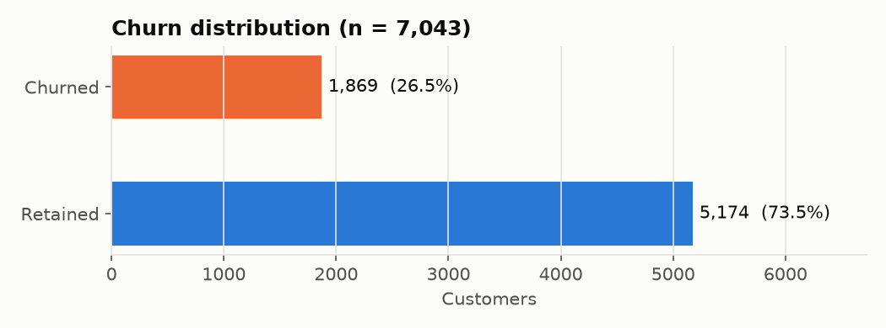
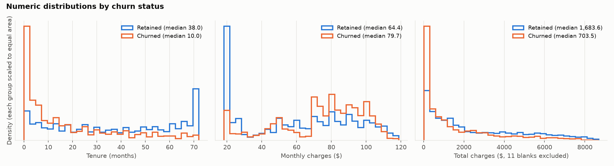
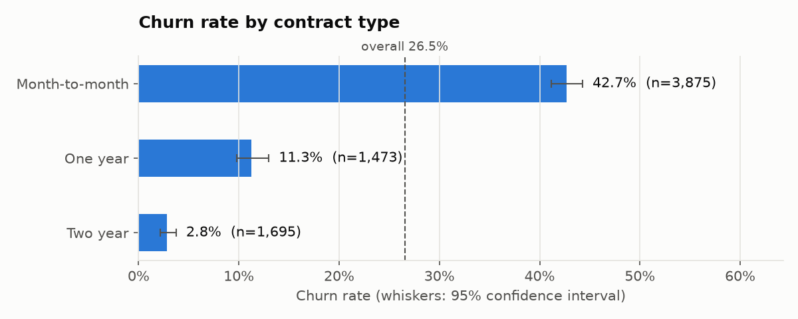
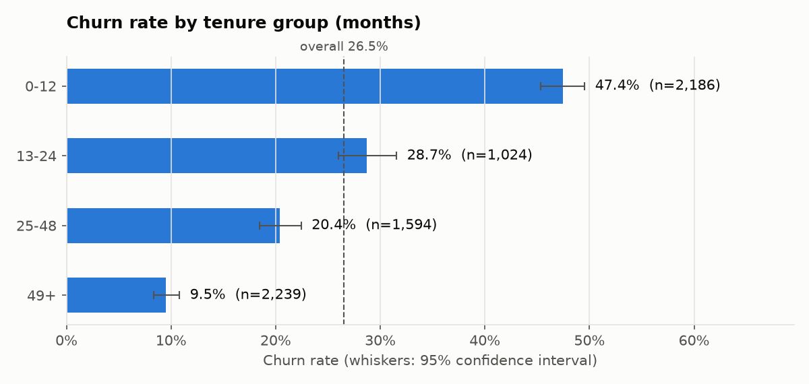
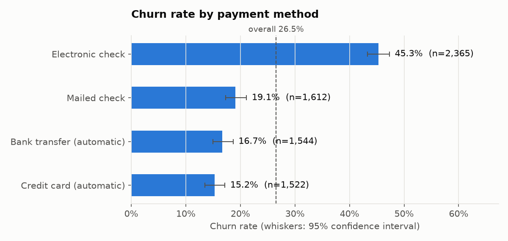
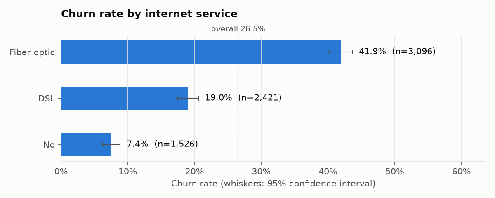
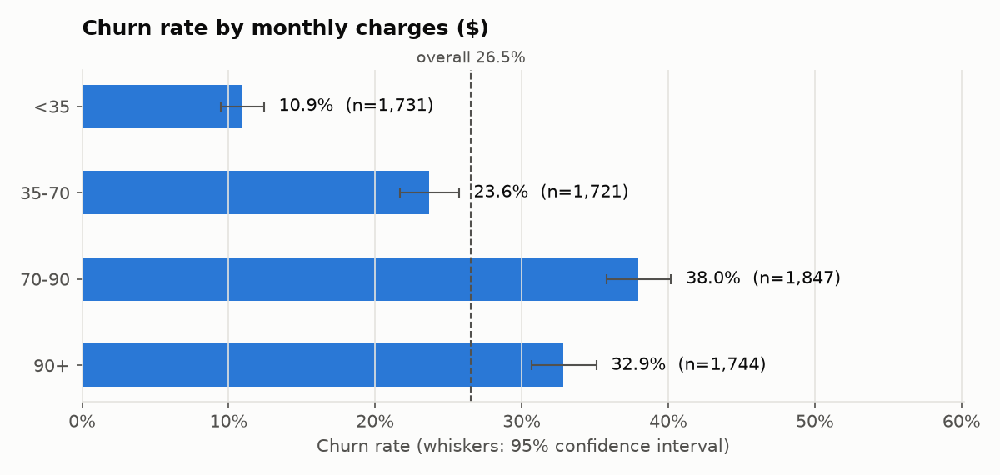
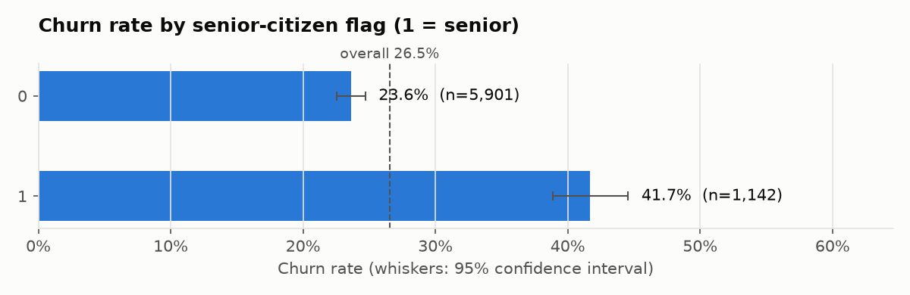
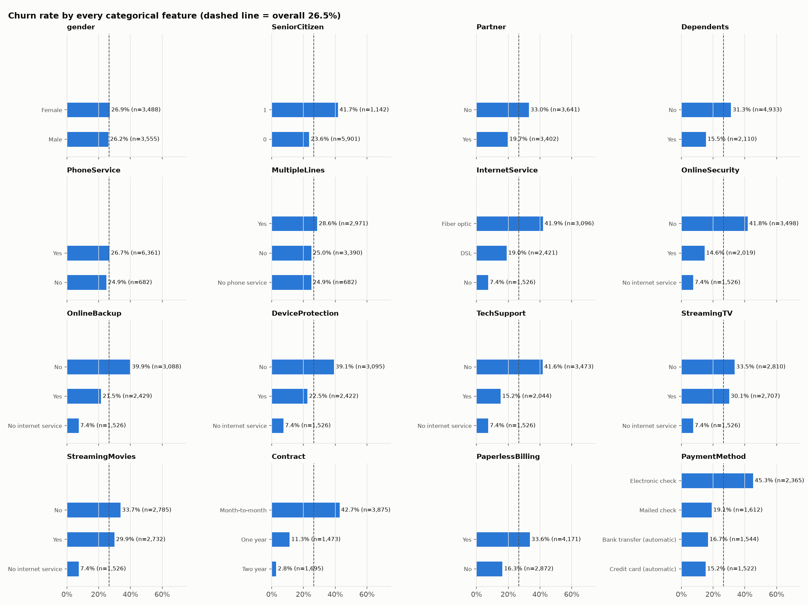

# Phase 2 findings: EDA and SQL insights

_Generated by `python -m churn_platform.eda` from `Telco-Customer-Churn.csv` (SHA-256 `16320c9c1ec72448…`). Do not edit by hand; re-run the script._

**All findings are descriptive associations in one observational snapshot. None of them shows that changing a factor would change churn.**

## 1. Target variable

- 7,043 customers: **1,869 churned (26.5%)**, 5,174 retained (73.5%).
- The classes are imbalanced. A model that always predicts "No churn" would be 73.5% accurate and useless, so accuracy alone will not be used to judge models.

## 2. Data quality

- All 21 raw columns are read as text. For analysis, `tenure` becomes an integer and `MonthlyCharges` / `TotalCharges` become floats.
- `TotalCharges` has **11 blank values** (a single space). They become NaN, **not 0**, and a `TotalCharges_blank` flag records them. All of them have `tenure = 0`. There are 11 tenure-0 customers in total. The raw CSV is unchanged.
- Duplicate customer IDs: 0. Fully identical rows: 0.
- **Duplicate feature profiles:** 73 customers (1.0%) fall into 33 groups that share every feature value but have different IDs (largest group: 4). **18 groups (42 customers) contain both churners and non-churners.** The features cannot tell those customers apart, so no model can classify all of them correctly. Tenure values in these rows: [1]. All of them are one-month customers, where TotalCharges equals one month's bill and profiles easily collide. Nothing was removed; see `tables/duplicate_profiles.csv`.
- `customerID` is treated purely as an identifier and is excluded from every analysis grouping.

## 3. Numeric distributions

| Column | Median (churned) | Median (retained) | Skew (all) |
|---|---:|---:|---:|
| tenure | 10.00 | 38.00 | 0.24 |
| MonthlyCharges | 79.65 | 64.43 | -0.22 |
| TotalCharges | 703.55 | 1,683.60 | 0.96 |

- Churned customers have shorter tenure (median 10 vs 38 months) and higher monthly charges (median $79.65 vs $64.43).
- Their lower `TotalCharges` (median $703.55 vs $1,683.60) follows from shorter tenure: corr(tenure, TotalCharges) = 0.826 and corr(MonthlyCharges, TotalCharges) = 0.651. TotalCharges / (tenure × MonthlyCharges) has median 1.0 (5th–95th percentile 0.924–1.075), so TotalCharges is close to tenure × MonthlyCharges and adds little independent information (a collinearity issue for Phase 3).
- Point-biserial correlation with churn: tenure -0.352, MonthlyCharges 0.193, TotalCharges -0.199. Correlation only measures linear association.
- **Caution about tenure:** for churned customers, tenure is how long they stayed *before leaving*. For retained customers it is still growing. Part of the tenure–churn gap is built into how the snapshot was taken, not just customer behaviour.

## 4. Churn by segment

### Contract type

| Contract | Customers | Churned | Churn rate | 95% CI |
|---|---:|---:|---:|---:|
| Month-to-month | 3,875 | 1,655 | 42.7% | 41.2%–44.3% |
| One year | 1,473 | 166 | 11.3% | 9.8%–13.0% |
| Two year | 1,695 | 48 | 2.8% | 2.1%–3.7% |

Highest: **Month-to-month** at 42.7% (95% CI 41.2%–44.3%, n=3,875). Lowest: **Two year** at 2.8% (95% CI 2.1%–3.7%, n=1,695). Ratio highest/lowest: 15.1x. The confidence intervals do not overlap.

### Tenure group (months)

| tenure_group | Customers | Churned | Churn rate | 95% CI |
|---|---:|---:|---:|---:|
| 0-12 | 2,186 | 1,037 | 47.4% | 45.4%–49.5% |
| 13-24 | 1,024 | 294 | 28.7% | 26.0%–31.6% |
| 25-48 | 1,594 | 325 | 20.4% | 18.5%–22.4% |
| 49+ | 2,239 | 213 | 9.5% | 8.4%–10.8% |

Highest: **0-12** at 47.4% (95% CI 45.4%–49.5%, n=2,186). Lowest: **49+** at 9.5% (95% CI 8.4%–10.8%, n=2,239). Ratio highest/lowest: 5.0x. The confidence intervals do not overlap.

### Payment method

| PaymentMethod | Customers | Churned | Churn rate | 95% CI |
|---|---:|---:|---:|---:|
| Electronic check | 2,365 | 1,071 | 45.3% | 43.3%–47.3% |
| Mailed check | 1,612 | 308 | 19.1% | 17.3%–21.1% |
| Bank transfer (automatic) | 1,544 | 258 | 16.7% | 14.9%–18.7% |
| Credit card (automatic) | 1,522 | 232 | 15.2% | 13.5%–17.1% |

Highest: **Electronic check** at 45.3% (95% CI 43.3%–47.3%, n=2,365). Lowest: **Credit card (automatic)** at 15.2% (95% CI 13.5%–17.1%, n=1,522). Ratio highest/lowest: 3.0x. The confidence intervals do not overlap.

### Internet service

| InternetService | Customers | Churned | Churn rate | 95% CI |
|---|---:|---:|---:|---:|
| Fiber optic | 3,096 | 1,297 | 41.9% | 40.2%–43.6% |
| DSL | 2,421 | 459 | 19.0% | 17.4%–20.6% |
| No | 1,526 | 113 | 7.4% | 6.2%–8.8% |

Highest: **Fiber optic** at 41.9% (95% CI 40.2%–43.6%, n=3,096). Lowest: **No** at 7.4% (95% CI 6.2%–8.8%, n=1,526). Ratio highest/lowest: 5.7x. The confidence intervals do not overlap.

### Monthly charges band ($)

| monthly_charges_band | Customers | Churned | Churn rate | 95% CI |
|---|---:|---:|---:|---:|
| <35 | 1,731 | 188 | 10.9% | 9.5%–12.4% |
| 35-70 | 1,721 | 407 | 23.6% | 21.7%–25.7% |
| 70-90 | 1,847 | 701 | 38.0% | 35.8%–40.2% |
| 90+ | 1,744 | 573 | 32.9% | 30.7%–35.1% |

Highest: **70-90** at 38.0% (95% CI 35.8%–40.2%, n=1,847). Lowest: **<35** at 10.9% (95% CI 9.5%–12.4%, n=1,731). Ratio highest/lowest: 3.5x. The confidence intervals do not overlap.

### Senior citizen (0 = no, 1 = yes)

| SeniorCitizen | Customers | Churned | Churn rate | 95% CI |
|---|---:|---:|---:|---:|
| 0 | 5,901 | 1,393 | 23.6% | 22.5%–24.7% |
| 1 | 1,142 | 476 | 41.7% | 38.9%–44.6% |

Highest: **1** at 41.7% (95% CI 38.9%–44.6%, n=1,142). Lowest: **0** at 23.6% (95% CI 22.5%–24.7%, n=5,901). Ratio highest/lowest: 1.8x. The confidence intervals do not overlap.

**Monthly charges:** churn does **not** rise steadily with price. The 90+ band (32.9%) is below the 70-90 band (38.0%). The relationship is not a simple "higher price, more churn" pattern; the reason is not established by this analysis.

Every other categorical feature is shown in `figures/churn_by_all_categorical_features.png` and `tables/categorical_churn_rates.csv`.

## 5. Interaction: contract × internet service

| Contract | Internet | Customers | % of customers | Churn rate | 95% CI |
|---|---|---:|---:|---:|---:|
| Month-to-month | Fiber optic | 2,128 | 30.2% | 54.6% | 52.5%–56.7% |
| Month-to-month | DSL | 1,223 | 17.4% | 32.2% | 29.7%–34.9% |
| One year | Fiber optic | 539 | 7.7% | 19.3% | 16.2%–22.8% |
| Month-to-month | No | 524 | 7.4% | 18.9% | 15.8%–22.5% |
| One year | DSL | 570 | 8.1% | 9.3% | 7.2%–12.0% |
| Two year | Fiber optic | 429 | 6.1% | 7.2% | 5.1%–10.1% |
| One year | No | 364 | 5.2% | 2.5% | 1.3%–4.6% |
| Two year | DSL | 628 | 8.9% | 1.9% | 1.1%–3.3% |
| Two year | No | 638 | 9.1% | 0.8% | 0.3%–1.8% |

The highest-churn segment is **Month-to-month + Fiber optic**: 54.6% churn among 2,128 customers (30.2% of all customers, 1,162 of the 1,869 churners = 62.2%).

Fiber optic churn exceeds DSL churn **within every contract type** (Month-to-month: 54.6% vs 32.2%; One year: 19.3% vs 9.3%; Two year: 7.2% vs 1.9%). Month-to-month churn is the highest contract rate **within every internet-service group**. Because each pattern persists after splitting by the other factor, neither one is simply a proxy for the other. This is still not evidence of causation: other variables (price, tenure, payment method) also differ between these groups.

## 6. SQL vs Python consistency

The SQLite view (`sql/create_analysis_view.sql`) does its own type conversion and grouping, independently of pandas. **7/7 queries match the pandas results** (counts exactly; rates to the 4 decimal places SQL rounds to).

| Query | Rows | Match |
|---|---:|---|
| `overall_churn` | 1 | yes |
| `churn_by_contract` | 3 | yes |
| `churn_by_tenure_group` | 4 | yes |
| `churn_by_payment_method` | 4 | yes |
| `monthly_charges_by_churn_status` | 2 | yes |
| `churn_by_monthly_charges_band` | 4 | yes |
| `segment_contract_internet` | 9 | yes |

## 7. Limitations: what this analysis does NOT show

- **Association, not causation.** Moving a customer to a two-year contract will not necessarily cut their churn risk to the two-year rate. Customers *choose* contracts, and the people who commit for two years probably differ in ways the data does not record.
- **Confounding.** Contract, tenure, internet service, price and payment method are related to each other. A one-variable table blends their effects together.
- **One snapshot, no dates.** We can't tell when customers churned, follow anyone over time, or tell voluntary from involuntary churn.
- **Synthetic data.** IBM created this dataset for demos. Patterns may not hold for a real business.
- **Confidence intervals** reflect sampling noise only and assume customers are independent. They do not cover bias or confounding.
- **Band boundaries** (tenure groups, charge bands) are round numbers chosen for readability. Different cut-offs would give somewhat different tables.

## 8. Implications for Phase 3 (noted, not yet acted on)

- Stratify the train/test split on `Churn` to keep the 26.5% rate in both sets.
- Decide how to handle the 11 blank `TotalCharges` values inside a training-only pipeline. Filling them with 0 is defensible since tenure = 0; dropping the column is also an option given its collinearity with tenure.
- Exclude `customerID` from the features.
- Expect label noise: 42 customers have identical profiles with mixed outcomes.
- Use precision, recall, F1, ROC-AUC and PR-AUC rather than accuracy.
