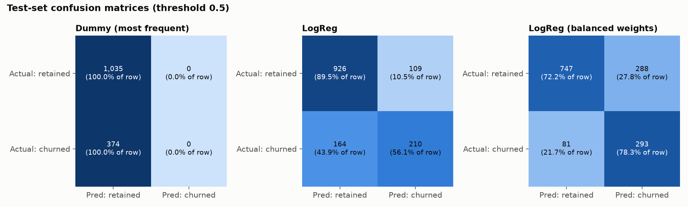

# Phase 3: baseline and logistic regression evaluation

_Generated by `python -m churn_platform.train_baseline` (raw SHA-256 `16320c9c1ec72448…`, scikit-learn 1.9.1, pandas 3.0.6, Python 3.11.9). Do not edit by hand._

## 1. Problem definition and an important caveat

- **Target:** `Churn` (Yes = 1, No = 0). **Predictors:** 19 columns, which is every column except `customerID` (an identifier) and the target.
- **This is a retrospective, cross-sectional exercise.** All columns were recorded at the same moment as the outcome. For a customer who already churned, `tenure` is *how long they stayed before leaving* and `TotalCharges` is their *final* bill, so both partly describe the churn itself. A deployable early-warning model would need features frozen at a prediction date and churn observed in a *later* window. These scores measure how well the features separate churners from non-churners in this snapshot. They are **not** a forecast of real-world performance.
- To size this effect, a model **without `tenure` and `TotalCharges`** was cross-validated: ROC-AUC 0.832 vs 0.846 with them (training-set CV only). So the other 17 features still separate the classes well. Which of them matter is not measured here; that is Phase 4. They aren't automatically safe either: a contract or payment method might also have changed shortly before a customer left, and the snapshot can't show that.

## 2. Split and leakage controls

- Stratified 80/20 split, seed 42: **train 5,634** (churn 26.5%), **test 1,409** (churn 26.5%). The split is saved to `data/processed/train_test_split.csv`.
- No customerID appears in both sets.
- All learned preprocessing (median imputer, scaler, one-hot categories) sits inside a scikit-learn `Pipeline`, fitted on training rows only. In cross-validation it is re-fitted within each fold.
- The imputation median for `TotalCharges` is $1,398.125, the median of the **training set**. 19 raw columns become 47 model inputs: 3 scaled numeric columns, 1 missing indicator, and the one-hot categories.
- Every choice in this report (imputation, class weights) was made with **5-fold CV on the training set**. The test set was scored once, after all choices were fixed.

### Train/test profile overlap

13 of 1,409 test customers (0.9%) have a feature profile identical to at least one training customer. For 6 the training labels agree; for 7 they differ or are mixed. These are **different customers** (IDs are unique), so this is not same-customer leakage, and they were not removed. Excluding them from the test set changes LogReg's test ROC-AUC from 0.8423 to 0.8431, so they don't inflate the score.

## 3. The 11 blank `TotalCharges` values

All 11 have tenure 0 and 0 of them churned. Contracts: Two year 10, One year 1. 8 are in train and 3 in test.

| Strategy | Assumption | CV ROC-AUC | CV PR-AUC |
|---|---|---:|---:|
| **Median + missing indicator** (primary) | none about what the blank means; the indicator lets the model treat those rows separately | 0.8463 ± 0.0126 | 0.6617 |
| Zero-fill | a tenure-0 customer has been billed $0. Plausible but unconfirmed | 0.8461 ± 0.0126 | 0.6615 |

The difference (0.0001) is far smaller than the fold-to-fold spread (0.0126), so **the choice makes no measurable difference**, which is expected when only 8 training rows are affected. The primary strategy was kept because it makes no assumption about what a blank means.

## 4. Cross-validation on the training set (5 folds, same folds for every model)

| Model | ROC-AUC | PR-AUC | Precision | Recall | F1 | Accuracy |
|---|---:|---:|---:|---:|---:|---:|
| Dummy (most frequent) | 0.500 ± 0.000 | 0.265 | 0.000 | 0.000 | 0.000 | 0.735 |
| LogReg | 0.846 ± 0.013 | 0.662 | 0.652 | 0.543 | 0.592 | 0.802 |
| LogReg, balanced weights | 0.846 ± 0.012 | 0.660 | 0.517 | 0.802 | 0.629 | 0.749 |
| LogReg, zero-fill | 0.846 ± 0.013 | 0.661 | 0.652 | 0.544 | 0.592 | 0.802 |
| LogReg without tenure & TotalCharges | 0.832 ± 0.009 | 0.612 | 0.630 | 0.523 | 0.571 | 0.792 |

The Dummy model never predicts churn, so its precision is 0/0 (undefined, shown as 0) and its recall is 0.

## 5. Test-set results (scored once, threshold fixed at 0.5)

| Metric | Dummy | LogReg | LogReg balanced |
|---|---:|---:|---:|
| Accuracy | 0.735 | 0.806 | 0.738 |
| Precision (churn) | 0.000 (undefined) | 0.658 | 0.504 |
| Recall (churn) | 0.000 | 0.561 | 0.783 |
| F1 (churn) | 0.000 | 0.606 | 0.614 |
| ROC-AUC | 0.500 | 0.842 | 0.842 |
| PR-AUC (average precision) | 0.265 | 0.634 | 0.633 |
| Brier score (lower = better) | 0.265 | 0.138 | 0.169 |

**Confusion matrices** (rows = actual, columns = predicted):

- Dummy (most frequent): TN 1035, FP 0, FN 374, TP 0 (flags 0 of 1409 customers; catches 0 of 374 churners)
- LogReg: TN 926, FP 109, FN 164, TP 210 (flags 319 of 1409 customers; catches 210 of 374 churners)
- LogReg, balanced weights: TN 747, FP 288, FN 81, TP 293 (flags 581 of 1409 customers; catches 293 of 374 churners)




<details><summary>Classification reports</summary>

**Dummy (most frequent)**

```
              precision    recall  f1-score   support

    Retained      0.735     1.000     0.847      1035
     Churned      0.000     0.000     0.000       374

    accuracy                          0.735      1409
   macro avg      0.367     0.500     0.423      1409
weighted avg      0.540     0.735     0.622      1409
```

**LogReg**

```
              precision    recall  f1-score   support

    Retained      0.850     0.895     0.872      1035
     Churned      0.658     0.561     0.606       374

    accuracy                          0.806      1409
   macro avg      0.754     0.728     0.739      1409
weighted avg      0.799     0.806     0.801      1409
```

**LogReg, balanced weights**

```
              precision    recall  f1-score   support

    Retained      0.902     0.722     0.802      1035
     Churned      0.504     0.783     0.614       374

    accuracy                          0.738      1409
   macro avg      0.703     0.753     0.708      1409
weighted avg      0.797     0.738     0.752      1409
```

</details>

## 6. Interpretation

- **Why accuracy is not enough:** the Dummy model scores 73.5% accuracy while catching **zero** churners. LogReg's 80.6% is only 7.2 points better. The balanced model catches more churners (293 vs 210) yet has *lower* accuracy (73.8%), because it raises more false alarms. Accuracy rewards getting the majority class right, which is the cheap part.
- **Ranking quality:** LogReg's test ROC-AUC is 0.842. PR-AUC is 0.634, against a no-skill level of 26.5% (the churn rate). PR-AUC focuses on the minority class, so it is the stricter number here.
- **Balanced weights vs unweighted:** test ROC-AUC 0.842 vs 0.842. The ranking of customers barely changes. What changes is *where 0.5 falls*: weighting pushes probabilities upward, so at 0.5 recall rises (0.561 → 0.783) and precision falls (0.658 → 0.504). Its Brier score is worse (0.169 vs 0.138). Since the ranking is nearly identical, that points to less faithful probabilities. A proper calibration check is Phase 4. Which trade-off is better depends on the cost of a missed churner versus a wasted retention offer, which is the Phase 4 threshold decision. **Unweighted LogReg is the primary model.** This was decided before the test set was scored: weighting mostly moves the effective threshold, and the threshold should be chosen explicitly from costs.
- **Overfitting check:** LogReg ROC-AUC is 0.849 on train, 0.846 in CV and 0.842 on test. The gap is small, so there is no sign of overfitting.

## 7. Limitations

- Retrospective snapshot (see section 1). Real-world performance is unknown.
- A single train/test split. A different seed would give somewhat different test numbers; the CV standard deviations give a sense of that spread.
- `C` (regularisation strength) was left at the default 1.0 and not tuned. The 0.5 threshold is arbitrary. Both are Phase 4 topics.
- Synthetic IBM data with label noise (customers with identical profiles but different outcomes).
- Coefficients are not interpreted yet. Correlated one-hot columns make raw coefficients misleading, and interpretation is a Phase 4 topic.
