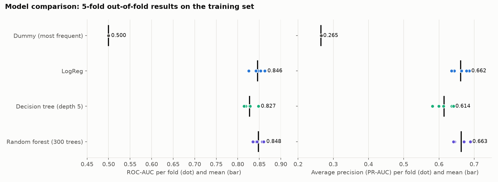
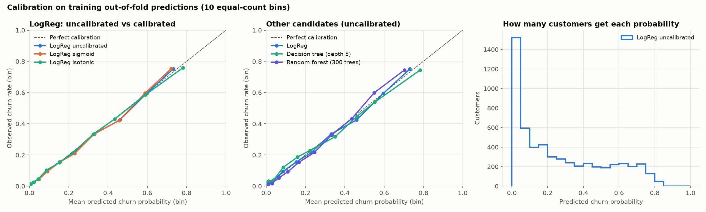
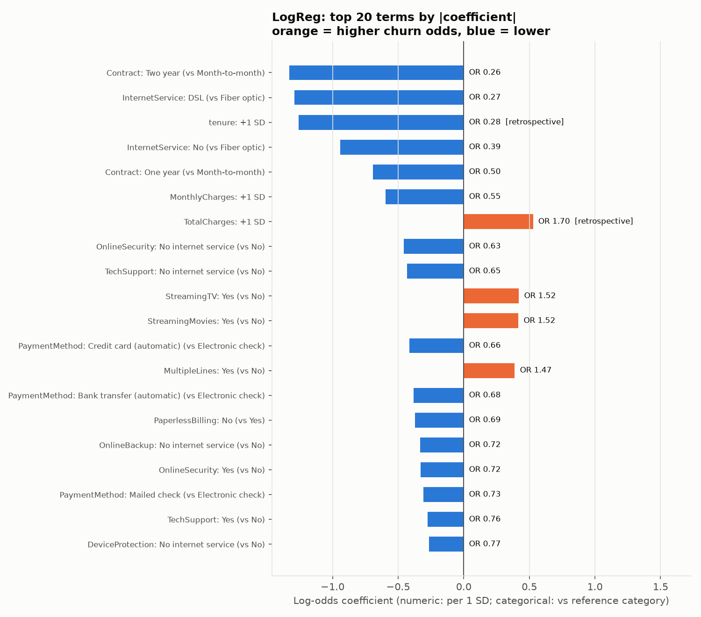
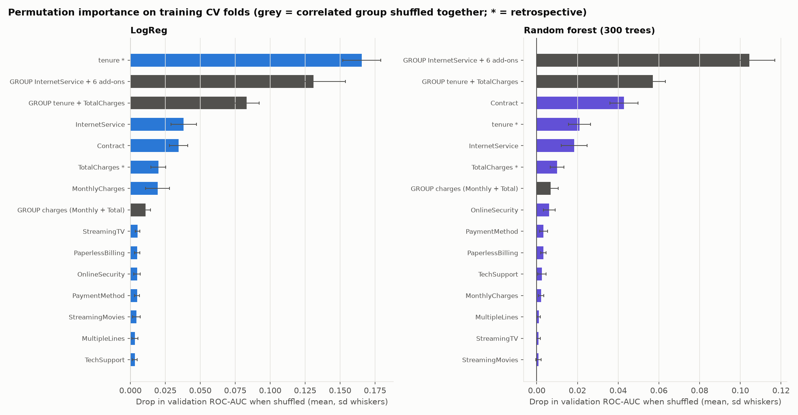

# Phase 4: model comparison, calibration, threshold and interpretation

_Generated by `python -m churn_platform.analyze_models` (raw SHA-256 `16320c9c1ec72448…`, scikit-learn 1.9.1). Do not edit by hand. Phase 3 outputs are not modified._

## 1. Decisions and the data behind each

| Decision | Result | Data used |
|---|---|---|
| Model | **LogReg** | 5-fold OOF on 5,634 training rows |
| Calibration | **uncalibrated** | same OOF folds; calibrators nested inside each fold |
| Threshold | **0.16** (0.5 kept as reference) | training OOF probabilities + **assumed** costs FP=1, FN=5 |
| Interpretation | coefficients + permutation importance | training fit; training validation folds |
| Final evaluation | one test run after decisions were saved | 1,409 held-out test rows |

Every decision rule was written before the results were known (see `model_selection.select_model`, `calibration.select_calibration`, `thresholds.select_threshold`).

## 2. Does another simple model beat logistic regression?

Candidates were chosen in advance and **not tuned**: a depth-5 decision tree (min 20 customers per leaf) and a random forest (300 trees, depth ≤ 8, min 10 per leaf). All use the same preprocessing and the **same 5 training folds** as Phase 3. Standard deviations here use n−1 (sample SD), so LogReg's fold SD reads slightly higher than Phase 3's population SD for identical fold scores.

| Model | ROC-AUC (mean ± sd) | AP (mean ± sd) | Precision@0.5 | Recall@0.5 | F1@0.5 | Accuracy@0.5 | Fit time / fold |
|---|---:|---:|---:|---:|---:|---:|---:|
| Dummy (most frequent) | 0.5000 ± 0.0000 | 0.2654 ± 0.0001 | 0.000 | 0.000 | 0.000 | 0.735 | 0.03 s |
| LogReg | 0.8463 ± 0.0140 | 0.6617 ± 0.0215 | 0.652 | 0.543 | 0.592 | 0.802 | 0.05 s |
| Decision tree (depth 5) | 0.8273 ± 0.0129 | 0.6144 ± 0.0247 | 0.631 | 0.530 | 0.573 | 0.792 | 0.04 s |
| Random forest (300 trees) | 0.8480 ± 0.0105 | 0.6634 ± 0.0201 | 0.679 | 0.493 | 0.571 | 0.803 | 0.82 s |

**Fold-level ROC-AUC / AP** (same rows in each fold for every model):

| Fold | Dummy (most frequent) | LogReg | Decision tree (depth 5) | Random forest (300 trees) |
|---|---:|---:|---:|---:|
| 0 | 0.5000 / 0.2653 | 0.8481 / 0.6440 | 0.8183 / 0.5998 | 0.8423 / 0.6445 |
| 1 | 0.5000 / 0.2653 | 0.8253 / 0.6359 | 0.8144 / 0.5819 | 0.8354 / 0.6414 |
| 2 | 0.5000 / 0.2653 | 0.8420 / 0.6860 | 0.8269 / 0.6363 | 0.8447 / 0.6892 |
| 3 | 0.5000 / 0.2653 | 0.8630 / 0.6782 | 0.8289 / 0.6130 | 0.8572 / 0.6709 |
| 4 | 0.5000 / 0.2655 | 0.8531 / 0.6644 | 0.8477 / 0.6408 | 0.8604 / 0.6708 |

**Paired difference vs LogReg** (candidate − LogReg, per fold):

| Model | ΔROC-AUC (mean ± SE) | folds better | ΔAP (mean ± SE) | folds better |
|---|---:|---:|---:|---:|
| Dummy (most frequent) | -0.3463 ± 0.0063 | 0/5 | -0.3964 ± 0.0096 | 0/5 |
| Decision tree (depth 5) | -0.0190 ± 0.0055 | 0/5 | -0.0473 ± 0.0069 | 0/5 |
| Random forest (300 trees) | +0.0017 ± 0.0033 | 3/5 | +0.0016 ± 0.0025 | 4/5 |

**Decision (pre-declared rule):** keep LogReg unless a candidate improves *both* ROC-AUC and AP by more than 2 standard errors of the paired difference. **Result: LogReg** (no candidate improved both ROC-AUC and AP by more than 2 SE of the paired fold difference).

- The random forest's ROC-AUC gain is +0.0017 (SE 0.0033, better in 3/5 folds). That is within noise. It also takes about 17× longer to fit, and it can't be read off as coefficients.
- The decision tree is worse (-0.0190 ROC-AUC, -0.0473 AP, better in 0/5 folds). A single depth-5 tree has only a limited number of distinct leaf probabilities, so it ranks customers coarsely.
- The fold SE is optimistic, because folds share training rows. With five folds this rule is a sanity check, not a significance test.

## 3. Are the probabilities trustworthy? (calibration)

Calibrated variants wrap the LogReg pipeline in `CalibratedClassifierCV` (inner 5-fold CV). This is nested inside each outer fold, so the calibrator never sees the labels it is evaluated on.

| Variant (training OOF) | Brier | Brier skill vs no-skill | Log loss | ECE (10 equal-count bins) | Mean predicted vs observed |
|---|---:|---:|---:|---:|---:|
| LogReg uncalibrated | 0.1350 | 0.307 | 0.4165 | 0.0101 | 26.6% vs 26.5% |
| LogReg sigmoid | 0.1351 | 0.307 | 0.4165 | 0.0120 | 26.6% vs 26.5% |
| LogReg isotonic | 0.1354 | 0.306 | 0.4180 | 0.0076 | 26.5% vs 26.5% |
| Decision tree (depth 5) | 0.1417 | 0.273 | 0.4737 | 0.0226 | 26.5% vs 26.5% |
| Random forest (300 trees) | 0.1348 | 0.308 | 0.4157 | 0.0183 | 26.5% vs 26.5% |

Folds where a calibrator lowered Brier: sigmoid 1/5, isotonic 2/5.

**Decision (pre-declared rule):** adopt a calibrator only if it lowers OOF Brier *and* log loss, and lowers Brier in at least 4 of 5 folds. **Result: uncalibrated** (no calibrator lowered OOF Brier and log loss while also lowering Brier in at least 4 of 5 folds).

- **How to read Brier:** Brier depends on the churn rate. Predicting the overall rate (26.5%) for everyone already scores 0.1949. LogReg's 0.1350 is a 30.7% improvement on that, and this mixes ranking skill with calibration. A low Brier alone doesn't prove good calibration.
- **Calibration evidence:** the average predicted probability (26.6%) matches the observed rate, the binned gap (ECE) is 0.0101, and the curve stays close to the diagonal. The threshold analysis below gives independent evidence: the cost-optimal thresholds land near the values theory predicts *for calibrated probabilities*.
- **Why calibration changed so little:** logistic regression is fitted by minimising log loss, so it tends to be calibrated already when the model is reasonably specified. Here both tree models have a higher ECE (0.0226, 0.0183) than uncalibrated LogReg.
- **Why ECE isn't the deciding metric:** isotonic has the lowest ECE (0.0076) but a worse Brier and log loss. ECE changes with the choice of bins and can be lowered by a calibrator that fits noise. Brier and log loss are proper scoring rules (they're best only for the true probabilities), so the rule uses them.
- **Limitations:** ECE depends on how many bins are used (10 bins of ~563 customers each). Few customers receive probabilities above 0.8, so the top end of the curve rests on less data.

## 4. Which threshold? (a business decision informed by the model)

The model outputs a probability. The **threshold** decides who gets flagged for retention:
- **Lower threshold:** more churners caught (fewer false negatives), but more offers go to customers who would have stayed (more false positives).
- **Higher threshold:** the reverse.

The right balance depends on what each mistake costs the business, which the data can't tell us.

`total_cost = FP × 1 + FN × 5`. **These costs are illustrative assumptions, not measured business values.** The default treats a missed churner as 5× as costly as an unnecessary offer. Thresholds 0.05–0.95 (step 0.01) are evaluated on **training out-of-fold probabilities**; ties go to the higher threshold.

If the probabilities are calibrated, theory says flag a customer when p > FP/(FP+FN) = 1/(1+ratio).

| FN:FP cost ratio | Theory | Selected (OOF) | Near-optimal band (≤1% above min) | Cost saving vs 0.5 | Precision | Recall | Customers flagged (of 5,634) |
|---:|---:|---:|---:|---:|---:|---:|---:|
| 1:1 | 0.500 | **0.55** | 0.48–0.57 | 1.3% | 0.686 | 0.486 | 1,058 |
| 2:1 | 0.333 | **0.33** | 0.31–0.35 | 8.4% | 0.560 | 0.739 | 1,972 |
| 3:1 | 0.250 | **0.28** | 0.25–0.28 | 20.1% | 0.532 | 0.790 | 2,221 |
| 5:1 | 0.167 | **0.16** | 0.14–0.17 | 38.0% | 0.446 | 0.906 | 3,041 |
| 10:1 | 0.091 | **0.08** | 0.07–0.13 | 59.5% | 0.385 | 0.956 | 3,712 |

**Selected for the illustrative 5:1 scenario: 0.16** (near-optimal band 0.14–0.17). On training OOF predictions this flags 3,041 customers and catches 1,355 of 1,495 churners (recall 0.906, precision 0.446). **The 0.5 baseline from Phase 3 is kept as a reference, not silently replaced.**

- **Theory vs data:** the theoretical threshold falls inside the near-optimal band for 5 of 5 cost ratios (largest gap to the selected value: 0.05). That is what calibrated probabilities predict.
- **When costs are equal (1:1),** the best threshold (0.55) saves only 1.3% versus 0.5. The 0.5 default is only sensible when both errors cost the same.
- **The higher the cost of a missed churner, the lower the threshold.** This is the key thing to explain to a business stakeholder.
- **The near-optimal band shows how much the exact value matters.** Within it, the choice can follow operational limits such as the size of the retention team.
- **The cost model is optimistic:** it assumes every contacted churner is saved and every offer costs the same.

## 5. Which features are associated with the predictions?

### 5a. Logistic regression coefficients (fitted on the full training set)

- **Numeric features:** effect per **1 training standard deviation**, because the inputs are scaled.
- **Categorical features:** effect **relative to the most common category**. All one-hot columns are kept, so only differences within a feature are meaningful.
- **Odds ratio (OR):** OR = exp(coefficient). OR 0.5 halves the odds of churn; OR 2 doubles them, *holding all other inputs fixed*.

| Rank | Feature | Term (vs reference) | Log-odds | Odds ratio | Direction | Early-warning status |
|---:|---|---|---:|---:|---|---|
| 1 | Contract | Two year (vs Month-to-month) | -1.329 | 0.26 | lower churn odds | usable if recorded before the prediction date |
| 2 | InternetService | DSL (vs Fiber optic) | -1.292 | 0.27 | lower churn odds | usable if recorded before the prediction date |
| 3 | tenure | +1 SD (24.6) | -1.258 | 0.28 | lower churn odds | retrospective (measured at churn for churners) |
| 4 | InternetService | No (vs Fiber optic) | -0.940 | 0.39 | lower churn odds | usable if recorded before the prediction date |
| 5 | Contract | One year (vs Month-to-month) | -0.694 | 0.50 | lower churn odds | usable if recorded before the prediction date |
| 6 | MonthlyCharges | +1 SD (30.1) | -0.597 | 0.55 | lower churn odds | usable if recorded before the prediction date |
| 7 | TotalCharges | +1 SD (2,277.6) | +0.528 | 1.70 | higher churn odds | retrospective (measured at churn for churners) |
| 8 | OnlineSecurity | No internet service (vs No) | -0.458 | 0.63 | lower churn odds | usable if recorded before the prediction date |
| 9 | TechSupport | No internet service (vs No) | -0.432 | 0.65 | lower churn odds | usable if recorded before the prediction date |
| 10 | StreamingTV | Yes (vs No) | +0.420 | 1.52 | higher churn odds | usable if recorded before the prediction date |
| 11 | StreamingMovies | Yes (vs No) | +0.416 | 1.52 | higher churn odds | usable if recorded before the prediction date |
| 12 | PaymentMethod | Credit card (automatic) (vs Electronic check) | -0.414 | 0.66 | lower churn odds | usable if recorded before the prediction date |
| 13 | MultipleLines | Yes (vs No) | +0.388 | 1.47 | higher churn odds | usable if recorded before the prediction date |
| 14 | PaymentMethod | Bank transfer (automatic) (vs Electronic check) | -0.382 | 0.68 | lower churn odds | usable if recorded before the prediction date |
| 15 | PaperlessBilling | No (vs Yes) | -0.372 | 0.69 | lower churn odds | usable if recorded before the prediction date |

Full table: `phase4/logreg_coefficients.csv`.

**A one-variable view and the model can disagree.** For `MonthlyCharges` (one-variable correlation with churn +0.198, model coefficient -0.597), `TotalCharges` (one-variable correlation with churn -0.195, model coefficient +0.528), the coefficient's sign is the opposite of the one-variable association. A coefficient answers "what if this changed *while every other input stays fixed*". The other inputs include closely related ones: corr(tenure, TotalCharges) = 0.829, corr(MonthlyCharges, TotalCharges) = 0.654, and the internet-service and add-on columns that make up much of a bill. For example, a higher TotalCharges *at the same tenure and monthly charge* is a different situation from simply a higher TotalCharges. Correlated inputs share and swap credit, so individual coefficients can't be read in isolation.

**Not causal.** A coefficient describes an association in this snapshot. A two-year contract's OR doesn't mean moving a customer to two years would cut their churn odds by that factor. Committed customers probably differ in ways the data doesn't record.

### 5b. Permutation importance (validation folds of the training set)

Each feature is shuffled in a validation fold, and the drop in ROC-AUC is measured (5 folds × 5 shuffles). Correlated features are also shuffled **as groups**.

| Feature / group | LogReg ΔAUC | Random forest ΔAUC |
|---|---:|---:|
| tenure | 0.1655 ± 0.0136 | 0.0210 ± 0.0054 |
| GROUP InternetService + 6 add-ons | 0.1311 ± 0.0227 | 0.1044 ± 0.0126 |
| GROUP tenure + TotalCharges | 0.0830 ± 0.0092 | 0.0570 ± 0.0061 |
| InternetService | 0.0381 ± 0.0091 | 0.0185 ± 0.0063 |
| Contract | 0.0345 ± 0.0064 | 0.0428 ± 0.0069 |
| TotalCharges | 0.0199 ± 0.0052 | 0.0100 ± 0.0033 |
| MonthlyCharges | 0.0195 ± 0.0086 | 0.0022 ± 0.0014 |
| GROUP charges (Monthly + Total) | 0.0108 ± 0.0036 | 0.0069 ± 0.0037 |
| StreamingTV | 0.0052 ± 0.0017 | 0.0009 ± 0.0010 |
| PaperlessBilling | 0.0049 ± 0.0019 | 0.0032 ± 0.0013 |
| OnlineSecurity | 0.0048 ± 0.0023 | 0.0062 ± 0.0028 |
| PaymentMethod | 0.0048 ± 0.0018 | 0.0034 ± 0.0019 |
| StreamingMovies | 0.0043 ± 0.0028 | 0.0009 ± 0.0013 |
| MultipleLines | 0.0032 ± 0.0021 | 0.0010 ± 0.0008 |

- **A trap:** for LogReg, shuffling `tenure` *alone* costs 0.166 AUC, *more* than shuffling tenure and TotalCharges together (0.083). Shuffling tenure alone creates impossible customers (e.g. 1 month of tenure with a $5,000 total bill), and the model uses the tenure/TotalCharges *combination*. The single-feature number therefore overstates tenure. **The group number is the more realistic measure.**
- Among the correlated groups, the largest drop is **GROUP InternetService + 6 add-ons** for LogReg (0.131) and **GROUP InternetService + 6 add-ons** for the forest (0.104). That group shuffles seven columns at once, and all seven encode whether the customer has internet service, so it removes more information than any single column.
- `Contract` alone: 0.034 (LogReg), 0.043 (forest). Features with a drop near zero (`Dependents`, `SeniorCitizen`, `PhoneService`, `Partner`, `gender`) add almost nothing *given the other features*. That doesn't mean they're unrelated to churn.
- Permutation importance measures how much **this model relies on** a feature. It doesn't show that the feature causes churn, and it shouldn't be confused with impurity-based tree importance (not used here).

### 5c. Retrospective importance vs early-warning suitability

`tenure` and `TotalCharges` rank high in both views, but for churners they are measured **at churn**. Shuffled together, they cost 0.083 AUC (LogReg). In Phase 3, removing them entirely lowered CV ROC-AUC from 0.846 to 0.832, because the model partly compensates with other features. For a real early-warning system, they would have to be re-measured at a prediction date *before* any churn. The other features are only safe if they're also recorded before the outcome. The snapshot can't confirm that (e.g. a contract switched just before leaving).

## 6. Held-out test set: one evaluation of the pre-declared final model

**Final model:** LogReg (uncalibrated), threshold 0.16. All of this was fixed from training data and written to `phase4/decisions.json` (SHA-256 `ced2782e3e4f0654…`) **before** this single test evaluation. Nothing below was used to make a choice.

| Test set (1,409 customers, 374 churners) | Threshold 0.16 (selected) | Threshold 0.5 (Phase 3 baseline) |
|---|---:|---:|
| Precision | 0.443 | 0.658 |
| Recall | 0.901 | 0.561 |
| F1 | 0.594 | 0.606 |
| Accuracy | 0.674 | 0.806 |
| TP (churners caught) | 337 | 210 |
| FP (unneeded offers) | 423 | 109 |
| FN (churners missed) | 37 | 164 |
| TN | 612 | 926 |
| Assumed cost (FP×1 + FN×5) | 608 | 929 |

Threshold-independent: ROC-AUC 0.8423, PR-AUC 0.6342, Brier 0.1380, log loss 0.4201, ECE 0.0182.

At 0.5 the confusion matrix is **identical to Phase 3's**, confirming that the final model is the same LogReg and the split is unchanged.

Under the *assumed* 5:1 costs, the selected threshold's test cost is 34.6% lower than at 0.5. This is a consistency check of the training-based choice, not a measured business saving.

## 7. Evidence vs assumptions

| Supported by computed evidence | Still an assumption |
|---|---|
| No tested alternative clearly beats LogReg on these folds | That no *untested* model or feature set would |
| LogReg OOF probabilities are close to calibrated | That calibration holds on future customers |
| Lower FN:FP cost ratios → higher optimal threshold | The actual cost ratio (5:1 is illustrative) |
| Which features the model relies on | That changing those features would change churn (causal) |
| Scores on this snapshot | Performance as a real early-warning system (tenure/TotalCharges are retrospective) |

## 8. Limitations

- Single synthetic snapshot. Associations only. Label noise from duplicate profiles with mixed outcomes.
- Five folds give rough uncertainty estimates, and fold scores aren't independent.
- Candidate models weren't tuned, so a tuned forest or gradient boosting *might* do better. This project deliberately keeps the search small.
- The cost model is a simplification: fixed costs, and it assumes every contacted churner is retained.
- The test set has now been used twice for the same LogReg (Phase 3 at 0.5, Phase 4 at the selected threshold). Neither result was used to choose anything. Any further model changes would need a fresh holdout or a new data sample.
